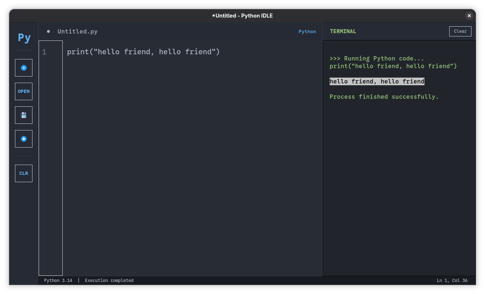

# My Python IDLE

A simple Python code editor built with Python and Tkinter, featuring a dark theme and a built-in output terminal.

## Features

- Dark-themed graphical interface
- Python code editor
- Open and save Python files
- Run Python code and view output
- Display runtime errors
- Keyboard shortcuts:
  - `Ctrl + N` — New file
  - `Ctrl + O` — Open file
  - `Ctrl + S` — Save file
  - `F5` — Run code

## Screenshot



## Requirements

- Python 3
- Tkinter

## Installation

Clone the repository:

```bash
git clone https://github.com/dvrone/my-python-idle.git
cd my-python-idle
```

Run the application:

```bash
python main.py
```

On Fedora, if Tkinter is not installed:

```bash
sudo dnf install python3-tkinter
```

## Project Structure

```text
my-python-idle/
├── diskette.png
├── LICENSE
├── main.py
├── play.png
├── plus.png
└── README.md
```

## Icons

- Add icon: [Pixel perfect — Flaticon](https://www.flaticon.com/free-icons/add)
- Save icon: [Magnific — Flaticon](https://www.flaticon.com/free-icons/save)
- Play icon: [IYAHICON — Flaticon](https://www.flaticon.com/free-icons/google-play-music)

## License

See [LICENSE](LICENSE) for details.
